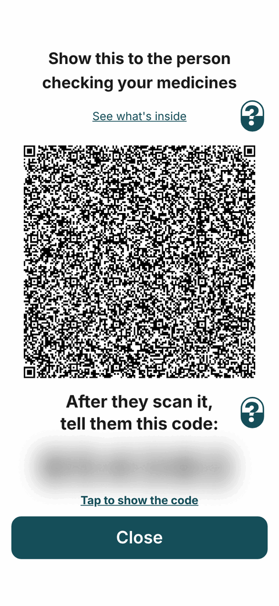
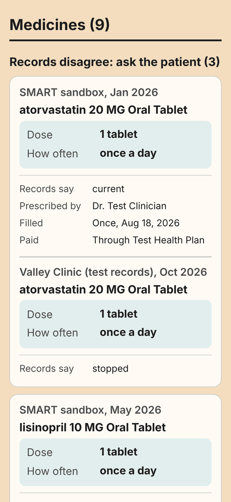

# Brown Bag

**Every pill bottle, without the bag.**


A SMART on FHIR R4 patient app that gives every healthcare worker an accurate
medication list. The patient signs in with their health system's portal;
Brown Bag reads their prescriptions, medicines, allergies and pharmacy fills,
adds what they take over the counter, and shares it all with one QR code.
When records disagree, it asks the patient and shows staff every version.
There's no Brown Bag server: it all runs in the browser.

**Live:** <https://burroclurse.github.io/BrownBag/>, with the SMART Health IT
sandbox's made-up [test patients](docs/SANDBOXES.md#test-patients) only. The
pictures are Riley Reconcile, also made up.
**Browse all patients**, at the end of the test patients, lists 491 of the
sandbox's 626 own patients (981 in all, counting ones others add): every
living one with a medicine record of any kind, and 25 who have died.

<p>



</p>

## Standards

| <small>Health data</small> | <small>Used for</small> |
| --- | --- |
| <small>[HL7 FHIR](https://hl7.org/fhir/R4/) R4</small> | <small>[Reads](#reads), [the QR code](#the-qr-code), [the FHIR file](#the-fhir-file)</small> |
| <small>[SMART App Launch](https://hl7.org/fhir/smart-app-launch/) 2, v2 scopes (v1 for older servers)</small> | <small>[Sign-in](#sign-in): a standalone patient launch</small> |
| <small>[US Core](https://hl7.org/fhir/us/core/), [CARIN Blue Button](https://hl7.org/fhir/us/carin-bb/)</small> | <small>The records and claims it [reads](#reads)</small> |
| <small>[IPS](https://hl7.org/fhir/uv/ips/) 2.0.1</small> | <small>[The FHIR file](#the-fhir-file)</small> |
| <small>[SMART Health Cards](https://spec.smarthealth.cards/), ideas only</small> | <small>[The QR code](#the-qr-code)'s trimmed Bundle</small> |
| <small>RxNorm, NDC, SNOMED CT, LOINC, UCUM</small> | <small>Medicine, package, allergy, document and unit codes</small> |

| <small>Security and access</small> | <small>Used for</small> |
| --- | --- |
| <small>[OAuth 2.0](https://www.rfc-editor.org/rfc/rfc6749) + [PKCE](https://www.rfc-editor.org/rfc/rfc7636) `S256`</small> | <small>[Sign-in](#sign-in), as a public client</small> |
| <small>[OpenID Connect](https://openid.net/specs/openid-connect-core-1_0.html), [revocation](https://www.rfc-editor.org/rfc/rfc7009)</small> | <small>Who signed in; ending it on sign out</small> |
| <small>[Web Crypto](https://www.w3.org/TR/WebCryptoAPI/), [WebAuthn](https://www.w3.org/TR/webauthn-3/) PRF</small> | <small>[The lock](#storage-and-the-lock) and the QR code</small> |
| <small>[CSP](https://www.w3.org/TR/CSP3/) Level 3</small> | <small>What each page may contact</small> |
| <small>[WCAG](https://www.w3.org/TR/WCAG22/) 2.2 AA</small> | <small>Every screen</small> |

## Front end: what people see

**The patient** ([full tour](docs/HOW-IT-WORKS.md#the-patient))
- **Lock, then sign-in:** Face ID, a fingerprint or a PIN, then **Connect
  your health records**. After that the lock opens the app and the list
  updates itself.
- **My medicines:** allergies first, then every source's medicines merged,
  each naming its sources and its insurance fills. Older prescriptions fold away.
- **When records disagree** on dose, how often or whether it's still taken,
  one card shows each version, and Brown Bag asks one question at a time,
  with "Not sure, ask my doctor".
- **Their own:** As needed, Not taking, and Add a medicine (checked against
  RxNorm). The saved list opens with no signal.
- **The QR code** fills the screen, with a 6-digit code to tell staff.

**The person checking medicines** ([in full](docs/HOW-IT-WORKS.md#the-person-checking-medicines))
- They scan the code and type the 6 digits: name, birth date, allergies,
  then medicines, each saying who says so.
- **"Records disagree: ask the patient"** comes first, with each source's
  version and date. A source that didn't load is named.
- The list never stays in the address, and a reload asks for the code again.
  **Save as FHIR file** saves an International Patient Summary.

## Back end: what happens behind the screen

The browser talks only to the health system and RxNav; [How it
works](docs/HOW-IT-WORKS.md) has every detail. Snippets use made-up values;
the scopes, addresses and codes are the app's own.

### Sign-in

A SMART standalone patient launch with fhirclient 3.0.1. It finds the sign-in
page in the server's `.well-known/smart-configuration`, then sends the patient
there with PKCE and read-only scopes:

```http
GET {authorization_endpoint}?response_type=code
    &client_id=my_web_app
    &redirect_uri=https://burroclurse.github.io/BrownBag/index.html
    &scope=launch/patient openid fhirUser offline_access patient/Patient.rs
           patient/MedicationRequest.rs patient/MedicationStatement.rs
           patient/Medication.rs patient/Practitioner.rs
           patient/ExplanationOfBenefit.rs patient/AllergyIntolerance.rs
    &aud={iss}&state={random}
    &code_challenge={SHA-256 of a random verifier}&code_challenge_method=S256
```

v2 scopes (`.rs`) when the server lists `permission-v2`, else v1 (`.read`).

The token answer names the patient. `offline_access` adds a refresh token,
which is kept encrypted on the phone and deleted (and revoked where the
server allows) on sign out:

```json
{ "token_type": "Bearer", "access_token": "eyJ…", "expires_in": 3600,
  "patient": "e7de504a-311d-49be-b2bc-566a328bcc72", "id_token": "eyJ…", "refresh_token": "…" }
```

### Reads

Every page of each search, then RxNav for ingredients and package codes.
Nothing is written back.

```http
GET {iss}/Patient/{patient}
GET {iss}/MedicationRequest?patient={patient}&_include=MedicationRequest:medication
GET {iss}/MedicationStatement?patient={patient}&_include=MedicationStatement:medication
GET {iss}/ExplanationOfBenefit?patient={patient}
GET {iss}/AllergyIntolerance?patient={patient}
Authorization: Bearer {access_token}
```

Each source's records are kept and compared fresh on every update; nothing
is overwritten. A second source joins only with the same name and birth date.

### Storage and the lock

The list, the patient's own entries and the refresh token are saved
encrypted (AES-GCM). The key comes from the PIN or from Face ID or a
fingerprint (shortened from `js/vault.js` and `js/lock.js`):

```js
// The PIN: PBKDF2 makes a 256-bit AES-GCM key.
subtle.deriveKey({ name: "PBKDF2", hash: "SHA-256", salt, iterations: 600000 },
  pinMaterial, { name: "AES-GCM", length: 256 }, false, ["encrypt", "decrypt"]);
// Face ID or a fingerprint: the passkey's PRF answer, shaped into a key by HKDF.
credentials.get({ publicKey: { rpId, extensions: { prf: { eval: { first: salt } } } } });
```

### The QR code

A trimmed FHIR `Bundle` of Patient, MedicationStatement and
AllergyIntolerance. Both sides of an unsettled disagreement go in, tied by a
`differs` tag:

```jsonc
{
  "resourceType": "Bundle", "type": "collection",
  "meta": { "tag": [{ "system": "https://burroclurse.github.io/BrownBag/tags",
                      "code": "differs", "display": "1 2" }] },
  "entry": [
    { "fullUrl": "resource:0", "resource": { "resourceType": "Patient",
        "name": [{ "text": "Jane Example" }], "birthDate": "1961-04-02" } },
    { "fullUrl": "resource:1", "resource": { "resourceType": "MedicationStatement",
        "status": "active", "subject": { "reference": "resource:0" },
        "medicationCodeableConcept": { "text": "lisinopril 10 MG Oral Tablet",
          "coding": [{ "system": "http://www.nlm.nih.gov/research/umls/rxnorm", "code": "314076" }] },
        "note": [{ "text": "From records: SMART sandbox" }, { "text": "Records disagree" }] } }
    // resource:2: the 20 mg side, "From records: Valley Clinic"
  ]
}
```

It's compressed, encrypted with a key made from the 6-digit code (PBKDF2,
AES-GCM), and written as digits after the `#`, which the browser never sends
to a server. The code itself is never in the link:

```
https://burroclurse.github.io/BrownBag/share.html#v3.29303036707643127053…
```

### The FHIR file

An IPS 2.0.1 document, made in the browser and checked with HL7's validator:

```jsonc
{
  "resourceType": "Bundle", "type": "document",
  "meta": { "profile": ["http://hl7.org/fhir/uv/ips/StructureDefinition/Bundle-uv-ips"] },
  "entry": [
    { "resource": { "resourceType": "Composition", "title": "Patient summary from Brown Bag",
        "type": { "coding": [{ "system": "http://loinc.org", "code": "60591-5" }] },
        "section": [
          { "title": "Medicines", "code": { "coding": [{ "system": "http://loinc.org", "code": "10160-0" }] } },
          { "title": "Allergies", "code": { "coding": [{ "system": "http://loinc.org", "code": "48765-2" }] } },
          { "title": "Problems",  "code": { "coding": [{ "system": "http://loinc.org", "code": "11450-4" }] } }
        ] } }
    // then the Patient, a Device named "Brown Bag", and each record the sections point to
  ]
}
```

## What's planned

Ideas become plans only after their own design; the reasons are in
[LIMITS](docs/LIMITS.md).

**Front end** (all ideas)
- **A second QR code**, a SMART Health Link a clinic's system can read. [#19](docs/LIMITS.md)
- **Scanning pill bottles** to fill the add form. [#4](docs/LIMITS.md)
- **Reading directions**: "1 tab PO BID" as "twice a day". [#24](docs/LIMITS.md)
- **A reminder before appointments.** [#1](docs/LIMITS.md)
- **When each source was last read.** [#21](docs/LIMITS.md)
- **Text past 200 percent** on My medicines, the QR screen and the staff page. [#28](docs/LIMITS.md)
- **The unnamed allergy's source**, once a second source sends allergies. [#17](docs/LIMITS.md)
- **When a record says the patient has died**, saying so plainly, for the patient and staff (designing next).

**Back end**
- **Medicare Part D fills** (designed and planned; waiting on Medicare's approval): one small server function that only handles Medicare's sign-in. [Design](docs/superpowers/specs/2026-11-22-medicare-blue-button-design.md)
- **Epic, Oracle Health, MEDITECH, Medicaid, pharmacy fills** (idea). [SANDBOXES](docs/SANDBOXES.md#sandboxes-looked-at)
- **SMART Health Links** (idea; needs a server to hold the file). [#19](docs/LIMITS.md)
- **Two sign-ins for one person** (idea; after Medicare). [#22](docs/LIMITS.md)
- **Sending changes back to the clinic** (idea; needs its permission). [#2](docs/LIMITS.md)
- **Testing at scale** (idea; the Colab notebook is the first piece). [#23](docs/LIMITS.md)
- **Nicknames and old names** (idea). [Research](docs/superpowers/research/2026-11-25-messy-data-findings.md)
- **A `DetectedIssue` in the FHIR file** (idea; waiting on IPS or US Core). [#26](docs/LIMITS.md)
- **HL7's validator on every push** (idea; run by hand today). [#20](docs/LIMITS.md)
- **A death date in the QR code and the FHIR file** (designing next), with the patient's screens.
- **Patient-reported medicines as US Core sends them** (idea): a MedicationRequest marked `reported`. [#29](docs/LIMITS.md)
- **Stronger same-person matching** (idea), as HL7's patient-matching guidance weighs it. [#30](docs/LIMITS.md)
- **Allergies coded in UNII** (idea), which US Core allows. [#31](docs/LIMITS.md)

## Run it

Node 22 or later: `node --test "tests/*.test.mjs"` runs the tests, and `node
tools/serve.mjs` serves the app at `https://localhost:8443` (passkeys need
https; the certificate comes from mkcert). Add `BROWN_BAG_DEMO=two-clinics`
for [a second test source](docs/SANDBOXES.md#the-home-servers-test-clinic).

## More docs

- [How it works](docs/HOW-IT-WORKS.md): the full tour.
- [Sandboxes and test patients](docs/SANDBOXES.md): who to sign in as.
- [Limits](docs/LIMITS.md): what can keep the list from matching what the patient takes.
- [Privacy](https://burroclurse.github.io/BrownBag/privacy.html) ([`privacy.html`](privacy.html)): what's kept and who can see it.

## Copyright

Copyright © 2026 Tyler Beattie. All rights reserved. The code is public to be
read; copying, using, changing or sharing it needs written permission. See
[`LICENSE`](LICENSE) and [`NOTICE.md`](NOTICE.md).

Brown Bag is not a medical device and does not give medical advice. The list
is what the patient and their records say; their care team confirms it.
