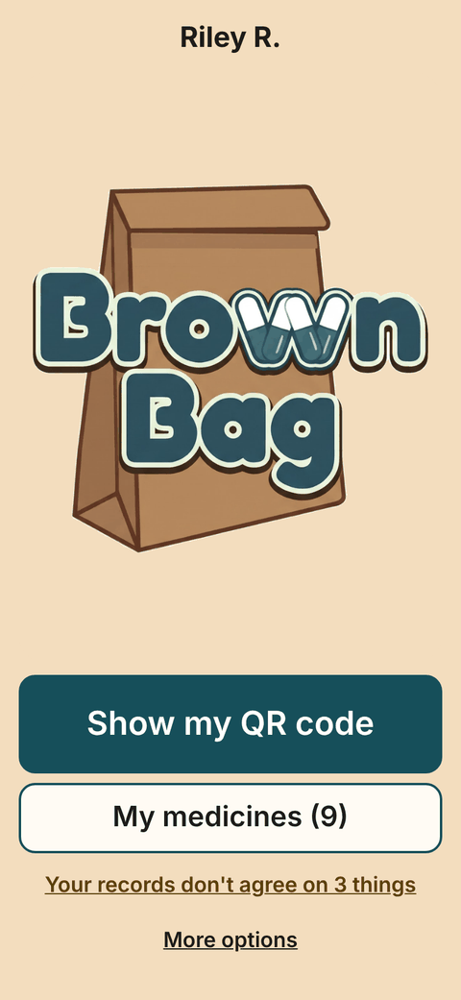
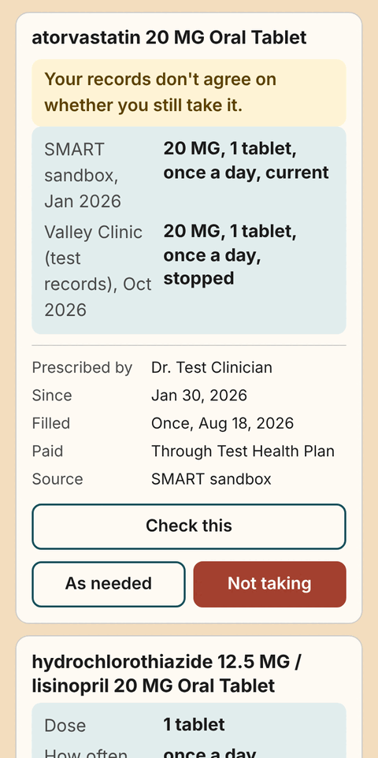

# Brown Bag

**Every pill bottle, without the bag.**

Brown Bag helps patients give every healthcare worker an accurate medication
list. It's a SMART on FHIR R4 patient app: the patient signs in with their
health system's patient portal, and Brown Bag gathers their prescriptions,
listed medicines, allergies and insurance pharmacy fills, adds what they take
over the counter, and shares the whole list with one QR code. When their
records disagree, it asks the patient, and shows staff every version until
the patient has answered.

It's for patients who see more than one care team, and the nurse, pharmacist
or front desk checking their medicines. Plain words, big buttons, WCAG 2.2 AA,
and no Brown Bag server: it all runs in the browser.

**Live:** <https://burroclurse.github.io/BrownBag/>. **Sandbox data only:** the
SMART Health IT sandbox's made-up [test patients](docs/SANDBOXES.md#test-patients).
The pictures are Riley Reconcile, made up, with the home server's test clinic.

## Front end: what people see

**The patient** ([the full tour](docs/HOW-IT-WORKS.md#the-patient))
- **Lock and sign-in:** a lock first (Face ID, a fingerprint or a 6-digit
  PIN), then **Connect your health records**. After that, the lock opens Brown
  Bag and the list updates by itself. It locks after 5 minutes idle.
- **My medicines:** allergies first, then the medicines from the records,
  repeats merged, directions in full, each card naming every source that
  lists it. Older prescriptions fold away, with a hospital's order for a stay
  among them, labelled "Hospital order".
- **Fills** from insurance claims: how many, and when last. When the newest is
  over a year old, the card says "Last filled over a year ago."
- **When sources disagree** on how much, how often or whether it's still
  taken, the medicine is one card with each source's version and date, and
  home and My medicines say "Your records don't agree on 3 things".
- **The review cards** ask one at a time ("Do you still take it?"), with each
  source's version, "I don't take this anymore" and "Not sure, ask my doctor".
  An answer reads "You said: …" with **Change**, and is asked again only when
  a source says something new.
- **As needed**, **Not taking** and **Add a medicine** (checked against
  RxNorm) are the patient's own. With no signal, the saved list still opens.
- **The QR code** fills the screen, with a 6-digit code to tell staff. **See
  what's inside** shows all of it. Birth dates read "Born May 8, 1974".

**The person checking medicines** ([in full](docs/HOW-IT-WORKS.md#the-person-checking-medicines))
- They scan the QR code and type the 6 digits in the **code box**: name, birth
  date, allergies, then the medicines in parts, each saying who says so.
- **"Records disagree: ask the patient"** comes first while the patient
  hasn't settled one: each source's version and date, with "Records say:
  current" or "stopped". A source that didn't load is named.
- **The fill hint**, "From the fill: about 2 a day (60 for 30 days)", is
  something to ask about, never the dose.
- The address drops the list as the page opens, so a copied address carries
  none. The tab keeps the list locked until it's closed: a reload asks for the
  code again. Back and Forward between two patients show each one's code box.
- **Save as FHIR file**: an International Patient Summary, after a warning.

## Back end: what happens behind the screen

Both halves are in full in [How it works](docs/HOW-IT-WORKS.md). Each page's
content security policy names what it may contact: the app, the sandbox and
RxNav; the staff page, nothing.

- **Sign-in:** a SMART patient standalone launch (fhirclient 3.0.1, PKCE,
  public client), read-only scopes and `offline_access`. The refresh token is
  encrypted (AES-GCM) with a key from the passkey (WebAuthn PRF) or the PIN
  (PBKDF2). Sign out deletes it, and revokes it where the server allows.
- **Reads:** Patient, MedicationRequest, MedicationStatement, pharmacy claims
  (ExplanationOfBenefit) and AllergyIntolerance, every page, plus RxNav for
  ingredients, term types and package codes. Nothing is written back.
- **Storage:** the list is saved encrypted on the phone. The patient's
  additions, marks and answers are saved the same way and go in backups; the
  list and the sign-in never do. The service worker keeps app files only.
- **Reconciliation:** every source's records are kept and compared fresh on
  each update; nothing is overwritten. A second source joins only with the
  same name and birth date. Today it's the home server's test clinic.
- **The QR code:** a FHIR `Bundle` (`collection`) of Patient,
  MedicationStatement and AllergyIntolerance, compressed and encrypted with a
  key made from the 6 digits, after the `#` of a `share.html` link. Each side
  of an unsettled disagreement goes in, tied by a `differs` tag, and a
  `source-not-loaded` tag names a source that didn't load.
- **The FHIR file:** IPS 2.0.1, made in the browser; HL7's validator passes
  its test files. A source with no medicines is said in the text. There's no
  `DetectedIssue`: IPS 2.0.1 allows only medicine records in that section.
- **The staff tab:** the locked list moves from the address into the history
  step's `history.state`, so a reload asks for the code, and Back or Forward
  reloads only when the step holds a different list.

## What's planned

What Brown Bag doesn't do yet. An idea becomes a plan only after its own
design; the reasons behind each are in [LIMITS](docs/LIMITS.md).

**Front end**
- **A second QR code** (idea): a SMART Health Link a clinic's system can read. [LIMITS #19](docs/LIMITS.md)
- **Scanning pill bottles** (idea): a model on the phone fills the add form. [LIMITS #4](docs/LIMITS.md)
- **Reading directions** (idea): "1 tab PO BID" read as "twice a day". [LIMITS #24](docs/LIMITS.md)
- **A reminder before appointments** (idea). [LIMITS #1](docs/LIMITS.md)
- **When each source was last read** (idea), with several sources. [LIMITS #21](docs/LIMITS.md)
- **Text past 200 percent** (idea): My medicines, the QR screen and the staff page's title fit. [LIMITS #28](docs/LIMITS.md)
- **The unnamed allergy's source** (idea): it names its source once a second source sends allergies. [LIMITS #17](docs/LIMITS.md)

**Back end**
- **Medicare Part D fills** (designed and planned; waiting on Medicare's approval). It adds one small server function, which only handles Medicare's sign-in and never sees the list. [Design](docs/superpowers/specs/2026-11-22-medicare-blue-button-design.md)
- **Epic, Oracle Health, MEDITECH, Medicaid, pharmacy fills** (idea; named on the connections screen). [SANDBOXES](docs/SANDBOXES.md#sandboxes-looked-at)
- **SMART Health Links** (idea; needs a server to hold the file). [LIMITS #19](docs/LIMITS.md)
- **Two sign-ins for one person** (idea; comes after Medicare). [LIMITS #22](docs/LIMITS.md)
- **Sending changes back to the clinic** (idea; needs its permission). [LIMITS #2](docs/LIMITS.md)
- **Testing at scale** (idea; the Colab notebook is the first piece). [LIMITS #23](docs/LIMITS.md)
- **Nicknames and old names** (idea): Bill and William stay apart; old names aren't compared. [Research](docs/superpowers/research/2026-11-25-messy-data-findings.md)
- **A `DetectedIssue` in the FHIR file** (idea; waiting on IPS or US Core). [LIMITS #26](docs/LIMITS.md)
- **HL7's validator on every push** (idea; run by hand today). [LIMITS #20](docs/LIMITS.md)

## Run it

Node 22 or later, nothing to install: `node --test "tests/*.test.mjs"` runs
the tests. On a phone, passkeys and encryption need https: `node
tools/serve.mjs` serves this folder at `https://localhost:8443` with a
certificate made with mkcert and kept in `.certs/`. For two sources, start
it with `BROWN_BAG_DEMO=two-clinics`. Both are in
[the test clinic](docs/SANDBOXES.md#the-home-servers-test-clinic).

## More docs

- [How it works](docs/HOW-IT-WORKS.md): the full tour, front end and back end.
- [Files](docs/FILES.md): what each file is for.
- [Sandboxes and test patients](docs/SANDBOXES.md): who to sign in as, and the test clinic.
- [Limits](docs/LIMITS.md): what can keep the list from matching what the patient takes.
- [Needs testing](docs/NEEDS-TESTING.md): what's waiting for a phone check.
- [Tyler needs to do](docs/TYLER-TODO.md) and [Decisions](docs/DECISIONS.md): what's open for Tyler, and who decided what.
- [Learning log](docs/LEARNING.md): each step, in plain words.
- [Privacy](https://burroclurse.github.io/BrownBag/privacy.html) ([`privacy.html`](privacy.html)): what's kept and who can see it.
- Designs and build plans: [`docs/superpowers/`](docs/superpowers/).

## Copyright

Copyright © 2026 Tyler Beattie. All rights reserved.

The code is public so that reviewers, instructors and the HL7 FHIR community
can read how it works. Reading it is welcome. Copying it, using it, changing
it or sharing it requires written permission. See [`LICENSE`](LICENSE). The
notices for the course starter, the libraries, LOINC, UCUM and trademarks are
in [`NOTICE.md`](NOTICE.md).

This list is what the patient and their records say. Their care team
confirms it. Brown Bag is not a medical device and does not give medical
advice.
